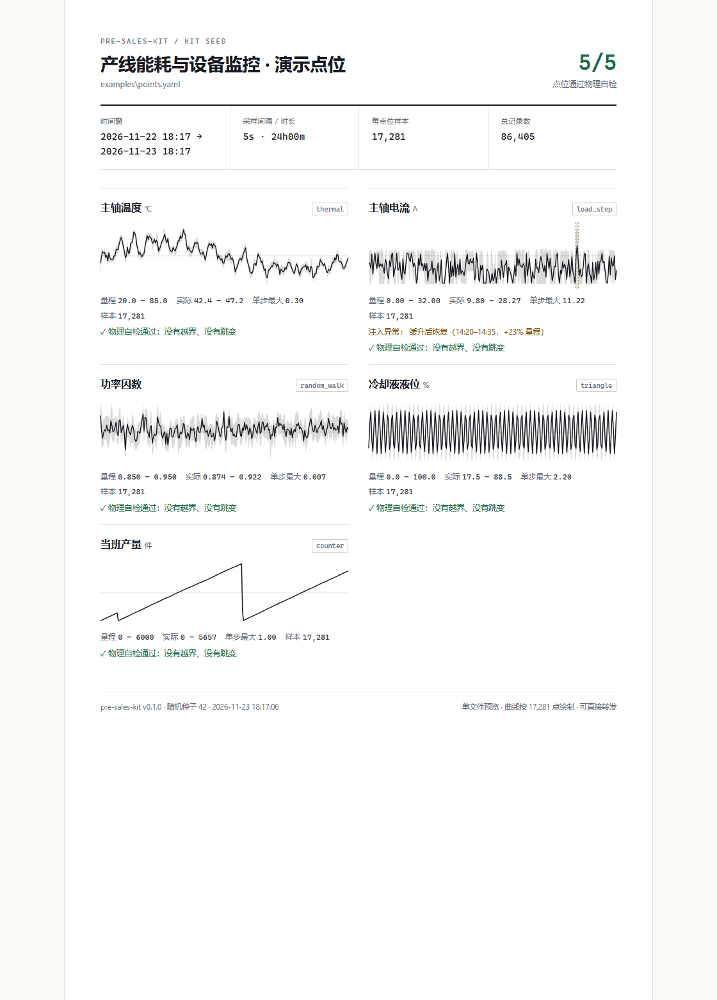
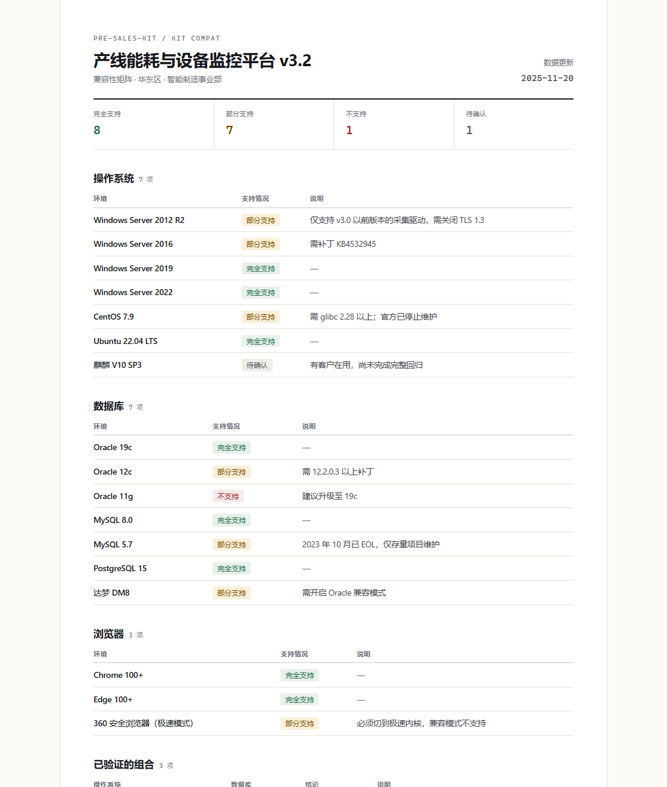

# pre-sales-kit · 售前现场工具箱

[](https://github.com/zhang1024899756/pre-sales-kit/actions/workflows/ci.yml)
[](https://pypi.org/project/pre-sales-kit/)
[](https://github.com/zhang1024899756/pre-sales-kit/blob/master/pyproject.toml)
[](LICENSE)

六个命令，对应售前技术支持真正在消耗时间的三件事，外加三件「装和用」的杂事：

| 命令 | 解决什么 | 一句话 |
| --- | --- | --- |
| **装完先跑** | | |
| `kit init` | 手上没有可跑的声明文件 | 生成三份能直接用的 YAML |
| `kit selfcheck` | 不确定装没装对 | 12 项安装自检，40ms 出结论 |
| **三个主力** | | |
| `kit doctor` | 现场演示环境起不来 | 出门前 30 秒体检，红黄绿一眼看完，能修的自动修 |
| `kit demo` | 演示服务要手工拼命令起 | 一条命令起/停/查，只碰自己起的进程 |
| `kit seed` | 演示数据一眼假 | 按物理模型生成：温度不会瞬跳、功率因数不会越界 |
| `kit compat` | 客户问兼容性要翻半天文档 | 一条命令给出结论，外加能贴进方案书的表格 |


所有命令共用一个 CLI，零外部服务依赖；报告是**单文件 HTML**（CSS 内嵌、无 CDN、无 JS），
双击即开、断网可看、微信直接发。

---

## 为什么做这个

不是因为它技术含量高——它不高。是因为这几件事有共同点：**高频、机械、出错代价大**。

- 会议室坐满、投影已经接上，服务没起来——这种翻车一次就够记一辈子。
- 演示数据里功率因数是 0.3、温度一秒跳 50 度——客户当场就能识破，后面的方案再漂亮也不作数。
- 客户问「支持 Oracle 11g 吗」，翻 PDF 翻五分钟，还答得不自信。

把这几件事做成工具，省下的不只是时间，是**现场那口气**：你不需要临场发挥。

---

## 安装

需要 Python 3.11 或 3.12。已发布到 PyPI：

```bash
pipx install pre-sales-kit     # 推荐：装成独立命令行工具，不污染项目环境
# 或
pip install pre-sales-kit

kit --version                  # 应输出 pre-sales-kit 0.2.0
kit selfcheck                  # 12 项安装自检
```

**内网离线安装**、**从源码装**、**多版本并存排查** 等四条路径见 **[docs/安装.md](docs/安装.md)**。

三个入口等价：`kit` / `pskit` / `python -m pre_sales_kit`。

---

## 60 秒上手

```bash
kit init                                                  # 1. 生成三份声明
kit seed -m examples/points.yaml -o examples/data/demo.db --interval 5s   # 2. 造数据
kit demo up --db examples/data/demo.db                    # 3. 起演示服务
kit doctor examples/doctor.yaml --html out/report.html     # 4. 体检，应该全绿
```

第 4 步的真实输出：

```text
  端口
    ✓ 演示门户端口              127.0.0.1:8080 正在监听 · 1ms · python.exe(PID 30996)
    ✓ 报警通知服务端口          127.0.0.1:6379 正在监听 · 0ms · python.exe(PID 34804)
  服务
    ✓ 门户健康检查              HTTP 200 · 6ms · application/json
    ✓ 趋势接口数据量            HTTP 200 · 2ms · application/json
  数据
    ✓ 演示数据新鲜度            measurements · 86,405 行 · 最新 29 秒前
  环境
    ✓ 磁盘空间                  C: 剩余 99.8GB（阈值 2.0GB）
    ✓ 主机时区                  +08:00 · 中国标准时间
    ! 控制台编码                系统首选编码是 cp936（期望 utf-8）
  版本
    ✓ python                    3.11.2 · 满足 >=3.11
    ✓ pre-sales-kit             0.2.0 · 满足 >=0.2
    ✓ typer                     0.29.2 · 满足 >=0.15
    ✓ rich                      15.0.0 · 满足 >=13.9
  网络
    ✓ 本机网络探针              演示门户回环 可达 · 0ms
  显示
    ✓ 分辨率                    3840×2160（阈值 1024×768）
    ✓ 浏览器                    Chrome 158.0.8127.36 · Edge 158.0.4370.33

  ──────────────────────────────────────────────────────────────
  10 通过 · 1 警告          共 11 项 · 114ms
  ! 可以出发，但有 1 项警告（「控制台编码」等），现场留意
```

如果第 4 步有红项，一条命令修到绿（会复检，不是「执行成功」就算数）：

```bash
kit doctor examples/doctor.yaml --fix --yes
```

---

## kit init：装完第一步

`kit doctor` / `kit seed` / `kit compat` 都要一份 YAML 才能工作，`kit init` 把三份都给你。

```bash
kit init                      # → ./examples/{doctor,points,matrix}.yaml
kit init demo --only doctor.yaml
kit init --list               # 只看有什么，不写文件
```

**已存在的文件默认不覆盖**——现场机器上的 YAML 往往已经按客户情况改过，那才是真的资产。
确实要覆盖加 `--force`，原文件会备份成 `.bak`。

导出后它会直接把下一步命令打出来（带你的目录名）。

---

## kit selfcheck：装对了吗

```bash
kit selfcheck            # 12 项，40ms
kit selfcheck --json     # 给 CI
```

查的是「装对了吗」，不只是「装了吗」：Python 版本、五个依赖的版本、**安装元数据与代码版本是否一致**、
报告模板与示例文件在不在、`kit` 是否在 PATH、控制台编码、输出目录可写。

现场最耗时间的失败不是报错，而是 `kit` 指向了另一个环境里的旧版本——它照样能跑，只是行为跟文档对不上。

---

## kit demo：演示服务

把「起一个能探测的服务」从手工拼命令变成一条命令。服务只用标准库，不需要额外装东西。

```bash
kit demo up                                   # 门户 8080 + 报警通知 6379
kit demo up --only portal
kit demo up --db examples/data/demo.db
kit demo up --service portal=8090             # 端口被占时换一个
kit demo status                               # 在跑 / 掉了 / 被别的进程占了
kit demo open                                 # 浏览器打开门户
kit demo down
```

```text
  启动
    ✓ 演示门户:8080         PID 30996 · 日志 demo-portal.log（启动器 32848 起的是子进程）
    ✓ 报警通知服务:6379     PID 34804 · 日志 demo-alarm.log
```

**安全边界：只停自己起的进程。** 端口被别的进程占着就不起、也不杀；
`down` 时如果端口上已经换成了陌生进程，只清记录、不动手。客户机器上的 8080 可能是他们真实的服务。

状态记在 `.kit/demo.json`，日志在 `.kit/demo-<role>.log`（起不来时先看这里）。

> 那行「启动器 … 起的是子进程」：Windows 上 `python.exe` 有时是个启动器，真正监听的是它拉起的子进程。
> 记录的是**真正在监听的那个 PID**——记错了，`status` 会说「这不是 kit 起的」，`down` 也会杀错。

---

## kit doctor：演示环境自检

检查项**不写在代码里**，写在 YAML 里。加一条检查不用改一行 Python：

```yaml
checks:
  - id: portal-health
    name: 门户健康检查
    type: service
    params:
      url: http://127.0.0.1:8080/health
      expect_status: 200
      body_contains: '"status": "ok"'   # 服务在，还要内容对
      retries: 2
    fix:
      action: start_service
      command: "{python} -m pre_sales_kit.demo --port 8080"
      wait: 2.5
```

七类检查：

| 类型 | 检查什么 | 典型失败 |
| --- | --- | --- |
| `port` | 端口在不在监听、该空的端口有没有被占 | 演示服务没起来 / 端口冲突 |
| `service` | HTTP 健康探测：状态码、响应体 | 服务在但接口内容不对 |
| `data` | 记录数、时间新鲜度 | 演示数据停在三天前 |
| `env` | 磁盘、时区、时钟偏差、控制台编码、证书 | 时区不对 → 「今天」判断全错 |
| `version` | 外部工具与 Python 依赖版本 | 现场机器上的 Node 版本过旧 |
| `network` | 内网 / 外网 TCP 可达性 | VPN 掉了 |
| `display` | 分辨率、浏览器版本 | 投影仪只有 1024×768 |

`--fix` 的设计要点：**修复后立刻复检**。执行成功不等于修好了，报告里写的是复检结果。
风险高的动作（例如会重写数据库的 `reseed`）默认不执行，要加 `--yes`。
修完还会做一轮**整体复检**：修好了 A，没配 fix 的 B 可能自己就好了。

输出四种形态，都是同一份结果的投影：终端红黄绿、单文件 HTML 报告、`--json`、退出码（给 CI）。

---

## kit seed：物理上说得通的演示数据

随机的数据一定假。假在**物理约束**上：

| 物理量 | 生成模型 | 假数据会犯的错 |
| --- | --- | --- |
| 温度 | `thermal`：一阶惯性 + 环境基线 + 日周期漂移 | 瞬间跳 50 度 |
| 电流 | `load_step`：负载阶跃 + 启动冲击（按采样区间取平均）+ 噪声 | 平滑正弦，一眼假 |
| 功率因数 | `random_walk`：有界均值回归，触边反弹 | 出现 0.3 这种物理不可能值 |
| 液位 / 压力 | `triangle`：进料 / 出料节奏，填充与排空速率不同 | 长期恒定不变 |
| 产量计数 | `counter`：按节拍出件 + 偶发停机 + 班次重置 | 计数会减小 |

两条硬约束贯穿始终：

1. **量程是死规定**：`range: [0.85, 0.95]` 的功率因数，生成完一个点都不会越界；
2. **变化率可信**：温度 5 秒内不会跳变几个百分点。

生成完会**自检**并逐项报告（越界数、单步最大跳变、计数是否回退、是否被四舍五入成一条直线）：

```text
  点位         模型          实际范围          单步最大   自检
  主轴温度     thermal       42.4 ~ 47.2 ℃     0.3        通过
  主轴电流     load_step     9.8 ~ 21.41 A     11.22      通过
  功率因数     random_walk   0.874 ~ 0.922     0.007      通过
  冷却液液位   triangle      17.5 ~ 88.5 %     2.2        通过
  当班产量     counter       0 ~ 5682 件       1          通过

  ✓ 5/5 点位物理自检通过（无越界、无异常跳变、计数不回退）
```

四种输出 + 一个预览：

```bash
kit seed -m points.yaml -o demo.db        # SQLite（演示后台直接读）
kit seed -m points.yaml -o demo.csv       # CSV（UTF-8 BOM，Excel 双击不乱码）
kit seed -m points.yaml -o - --format jsonl | head    # JSONL 管道
kit seed -m points.yaml -o demo.db --url http://localhost:9000/api/ingest
kit seed -m points.yaml -o demo.db --html preview.html
```

异常注入用于配合告警演示——注入的是**物理上仍然成立**的异常：

```bash
# 14:20-14:35 电流缓升 23% 量程，然后恢复
kit seed -m points.yaml -o demo.db --inject-fault 14:20-14:35 \
    --fault-point 主轴电流 --fault-kind ramp --fault-magnitude 0.23
```

同一条命令 + 同一个 `--seed` 永远生成同一份数据，便于截图、比对和复现问题。



---

## kit compat：兼容性一条命令

矩阵是 YAML，**加维度不用改代码**（顶层除保留字段外，每个键就是一个维度）：

```yaml
product: 产线能耗与设备监控平台 v3.2
os:
  - { name: Windows Server 2016, status: partial, note: 需补丁 KB4532945 }
  - { name: Windows Server 2019, status: full }
db:
  - { name: Oracle 11g, status: unsupported, note: 建议升级至 19c }
combinations:                       # 显式组合优先于单维度推断
  - { os: Windows Server 2016, db: Oracle 11g, status: unsupported, note: 补丁依赖冲突 }
```

```text
$ kit compat check --os "Windows Server 2016" --db "Oracle 11g"

  维度     查询值                结论     说明
  操作系统  Windows Server 2016   部分支持  需补丁 KB4532945
  数据库    Oracle 11g             不支持    建议升级至 19c

  结论
    ✗ 不支持  不应承诺：这个组合不受支持
    → 补丁依赖与 Oracle 11g 客户端冲突。应答为「不支持」，同时给出替代方案。
```

匹配是渐进的：精确 → 包含 → 前缀 → 近似（`centos` 能命中 `CentOS 7.9`），
近似匹配会在结论里标出来，不悄悄替你认领。维度没收录、维度不存在，都不会被猜成「支持」。

导出给方案书用：

```bash
kit compat matrix --html out/matrix.html --brand "XX 科技"   # 单文件表格
kit compat matrix --md out/matrix.md                          # Markdown 表格
```



---

## 设计取舍

| 决定 | 原因 |
| --- | --- |
| CLI + 单文件 HTML，不做 GUI | 现场要的是 30 秒出结论，不是点十下鼠标 |
| 报告零外部资源（无 CDN / 字体 / JS） | 客户机房经常没有外网 |
| 检查项写在 YAML | 每个客户现场的关注点不同，工具要能被现场的人改 |
| 不接 LLM | 这个工具的价值是**确定性**：同样的输入永远同样的结论 |
| 修完必须复检 | 「执行成功」和「问题解决」是两件事 |
| 高风险修复要 `--yes` | 会重写数据 / 杀进程的动作不能悄悄发生 |
| `kit demo` 只停自己起的进程 | 客户机器上的 8080 可能是他们真实的服务 |
| 示例文件打进 wheel，不靠仓库 | 从 PyPI 装出来的人没有 `examples/`，`kit init` 才装完就能用 |
| 记录真实监听 PID，不记 Popen 返回的 | Windows 上 `python.exe` 可能是启动器，记错了 status 会否认、down 会杀错 |
| `kit init` 默认不覆盖 | 现场改过的 YAML 才是资产 |
| 支持 macOS / Linux，但 Windows 优先 | 客户现场 90% 是 Windows 笔记本 |

---

## 退出码

| 码 | selfcheck | doctor | seed | compat |
| --- | --- | --- | --- | --- |
| `0` | 无失败 | 无失败（警告不算，`--strict` 时算） | 生成并自检通过 | 组合完全支持 |
| `1` | 有失败项 | 有失败项 | — | 组合不支持 |
| `2` | — | 声明文件 / 运行错误 | 声明文件 / 输出错误 | 矩阵 / 参数错误 |
| `3` | — | — | 数据自检未通过（已落盘） | 有条件支持 |
| `4` | — | — | — | 维度未收录，需确认 |

---

## 开发

```bash
uv venv && uv pip install -e ".[dev]"
pytest -q          # 191 条测试
ruff check src tests   # 0 issue
mypy src               # 0 error
```

目录结构：

```text
src/pre_sales_kit/
├─ cli.py                 # 六个子命令，只负责解析参数
├─ selfcheck.py           # 安装自检的 12 项
├─ core/                  # 状态词表、单位解析、进程探测、终端输出（含中文宽度对齐）
├─ scaffold/              # kit init 的示例样板（打进 wheel，是它们的唯一副本）
├─ demo/                  # 演示服务 + kit demo 的启停逻辑
│  ├─ app.py              #   只用标准库的最小 HTTP 服务
│  └─ manager.py          #   状态文件、真实监听 PID、只停自己的进程
├─ doctor/
│  ├─ spec.py             # YAML 声明加载（未知字段直接报错）
│  ├─ checks/             # 七类检查，每类一个文件
│  ├─ runner.py           # 执行、超时保护、修复后复检
│  └─ report.py           # 单文件 HTML 报告
├─ seed/
│  ├─ generators.py       # 五种物理模型
│  ├─ faults.py           # 异常注入（注入后仍然物理成立）
│  ├─ sinks.py            # SQLite / CSV / JSONL / HTTP
│  └─ preview.py          # 预览页（min/max 包络 + 均值线）
├─ compat/                # 矩阵加载、匹配、结论、HTML/Markdown 导出
└─ templates/             # Jinja2 模板，共用一套排版 tokens
tests/                    # 191 条：模型不变量、匹配、CLI 端到端、报告离线校验、进程启停
```

`examples/` 不入库：它由 `kit init examples` 生成，唯一副本在 `src/pre_sales_kit/scaffold/`。

---

## 文档

- [安装](docs/安装.md)：四种装法、内网离线安装、装不上时按症状查
- [使用](docs/使用.md)：六个命令的完整参考、YAML 字段、结论怎么读、脚本化
- [售前现场工作流](docs/售前现场工作流.md)：出差前一晚做什么、到现场前 10 分钟做什么、客户问兼容性怎么答
- 示例产物：[doctor 报告](docs/samples/doctor-report.html) ·
  [数据预览](docs/samples/seed-preview.html) ·
  [兼容性矩阵](docs/samples/compat-matrix.html) ·
  [Markdown 表格](docs/samples/compat-matrix.md)

---

## 已知限制

- `env` 的证书检查需要 `openssl` 或 Python 自带解码器；自签证书也能读（只看有效期）。
- `display` 的分辨率检查仅支持 Windows（macOS / Linux 会跳过并说明原因）。
- `service` 只做 HTTP，不支持 gRPC / WebSocket。
- 点位表归一化（Excel 格式千奇百怪）故意没做——那是另一个工具的事。
- `kit demo` 起的是**没有业务逻辑的假服务**，用来被探测和顶位，不是演示产品本身。

## License

MIT
