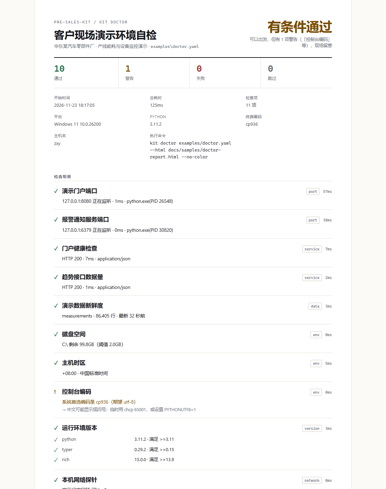

# pre-sales-kit · 售前现场工具箱

三个命令，对应售前技术支持每天都在消耗时间的三件事：

| 命令 | 解决什么 | 一句话 |
| --- | --- | --- |
| `kit doctor` | 现场演示环境起不来 | 出门前 30 秒体检，红黄绿一眼看完，能修的自动修 |
| `kit seed` | 演示数据一眼假 | 按物理模型生成数据：温度不会瞬跳、功率因数不会越界 |
| `kit compat` | 客户问兼容性要翻半天文档 | 一条命令给出结论，外加能贴进方案书的表格 |



三个工具共用一个 CLI，零外部服务依赖；报告是**单文件 HTML**（CSS 内嵌、无 CDN、无 JS），
双击即开、断网可看、微信直接发。

---

## 为什么做这个

不是因为它技术含量高——它不高。是因为这三件事有共同点：**高频、机械、出错代价大**。

- 会议室坐满、投影已经接上，服务没起来——这种翻车一次就够记一辈子。
- 演示数据里功率因数是 0.3、温度一秒跳 50 度——客户当场就能识破，后面的方案再漂亮也不作数。
- 客户问「支持 Oracle 11g 吗」，翻 PDF 翻五分钟，还答得不自信。

把这三件事做成工具，省下的不只是时间，是**现场那口气**：你不需要临场发挥。

---

## 安装

需要 Python 3.11+。

```bash
# 从源码装（现在就能跑）
git clone https://github.com/arvinzxy/pre-sales-kit && cd pre-sales-kit
uv venv && uv pip install -e ".[dev]"

# 从 PyPI 装成独立命令（发布后可用）
pipx install pre-sales-kit
```

装好之后有三个等价的入口：`kit`、`pskit`、`python -m pre_sales_kit`。

---

## 60 秒上手

仓库自带一套可以直接跑的示例（含一个只用标准库写的演示服务）：

```bash
# 1. 体检：先看哪里不对（此时演示服务没起、数据也还没生成）
kit doctor examples/doctor.yaml

# 2. 一键修复：拉起两个演示服务 + 重置演示数据，然后逐项复检
kit doctor examples/doctor.yaml --fix --yes

# 3. 现在再体检一次，顺便出报告
kit doctor examples/doctor.yaml --html out/doctor-report.html

# 4. 生成物理合理的演示数据（带异常注入和预览图）
kit seed -m examples/points.yaml -o examples/data/demo.db   --inject-fault 14:20-14:35 --fault-point 主轴电流 --fault-magnitude 0.23   --html out/seed-preview.html

# 5. 兼容性：客户报的组合一句话得到结论
kit compat check -m examples/matrix.yaml --os "Windows Server 2016" --db "Oracle 11g"
```

真实的终端输出长这样：

```text
  kit  ·  客户现场演示环境自检
  华东某汽车零部件厂 · 产线能耗与设备监控演示
  2026-11-23 17:47:14 · Windows 11 10.0.26200 · Python 3.11.2
  examplesdoctor.yaml

  端口
    ✗ 演示门户端口              127.0.0.1:8080 未监听：连接超时（1s 无响应）
      → 演示服务没起来。在 YAML 里配 fix: start_service 可以自动拉起
  服务
    ✗ 门户健康检查              连不上：连接被拒绝（端口没有服务在监听）
  数据
    ✗ 演示数据新鲜度            数据文件不存在：datademo.db
  环境
    ✓ 磁盘空间                  C: 剩余 100.0GB（阈值 2.0GB）
    ! 控制台编码                系统首选编码是 cp936（期望 utf-8）
  显示
    ✓ 分辨率                    3840×2160（阈值 1024×768）
    ✓ 浏览器                    Chrome 158.0.8127.36 · Edge 158.0.4370.33

  ──────────────────────────────────────────────────────────────
  4 通过 · 1 警告 · 6 失败          共 11 项 · 15.0s
  ✗ 有 6 项失败：先处理「演示门户端口」再出发
```

加 `--fix` 之后：

```text
  端口
    ✓ 演示门户端口              127.0.0.1:8080 正在监听 · 12ms · python.exe(PID 36168)
    ✓ 报警通知服务端口          127.0.0.1:6379 正在监听 · 0ms · python.exe(PID 35724)
  数据
    ✓ 演示数据新鲜度            measurements · 86,405 行 · 最新 3 分钟前
  ...
  修复
    ✓ 拉起服务 · 演示门户端口    已启动（PID 36168），等待 2.5s · 复检通过
    ✓ 重置演示数据 · 演示数据新鲜度  命令执行完成（退出码 0） · 复检通过

  10 通过 · 1 警告          共 11 项 · 7.2s
  ! 可以出发，但有 1 项警告（「控制台编码」等），现场留意
```

---

## kit doctor：演示环境自检

检查项**不写在代码里**，写在 YAML 里。加一条检查不用改一行 Python：

```yaml
checks:
  - id: portal-health
    name: 门户健康检查
    type: service
    params:
      url: http://127.0.0.1:8080/health
      expect_status: 200
      body_contains: '"status": "ok"'   # 服务在，还要内容对
      timeout: 3
      retries: 2
    fix:
      action: start_service
      command: "{python} {spec_dir}/demo_app.py --port 8080"
      wait: 2.5
```

七类检查：

| 类型 | 检查什么 | 典型失败 |
| --- | --- | --- |
| `port` | 端口在不在监听、该空的端口有没有被占 | 演示服务没起来 / 端口冲突 |
| `service` | HTTP 健康探测：状态码、响应体 | 服务在但接口内容不对 |
| `data` | 记录数、时间新鲜度 | 演示数据停在三天前 |
| `env` | 磁盘、时区、时钟偏差、控制台编码、证书 | 时区不对 → 「今天」判断全错 |
| `version` | 外部工具与 Python 依赖版本 | 现场机器上的 Node 版本过旧 |
| `network` | 内网 / 外网 TCP 可达性 | VPN 掉了 |
| `display` | 分辨率、浏览器版本 | 投影仪只有 1024×768 |

`--fix` 的设计要点：**修复后立刻复检**。执行成功不等于修好了，报告里写的是复检结果。
风险高的动作（例如会重写数据库的 `reseed`）默认不执行，要加 `--yes`。

输出四种形态，都是同一份结果的投影：终端红黄绿、单文件 HTML 报告、`--json`、退出码（给 CI）。


---

## kit seed：物理上说得通的演示数据

随机的数据一定假。假在**物理约束**上：

| 物理量 | 生成模型 | 假数据会犯的错 |
| --- | --- | --- |
| 温度 | `thermal`：一阶惯性 + 环境基线 + 日周期漂移 | 瞬间跳 50 度 |
| 电流 | `load_step`：负载阶跃 + 启动冲击（按采样区间取平均）+ 噪声 | 平滑正弦，一眼假 |
| 功率因数 | `random_walk`：有界均值回归，触边反弹 | 出现 0.3 这种物理不可能值 |
| 液位 / 压力 | `triangle`：进料 / 出料节奏，填充与排空速率不同 | 长期恒定不变 |
| 产量计数 | `counter`：按节拍出件 + 偶发停机 + 班次重置 | 计数会减小 |

两条硬约束贯穿始终：

1. **量程是死规定**：`range: [0.85, 0.95]` 的功率因数，生成完一个点都不会越界；
2. **变化率可信**：温度 5 秒内不会跳变几个百分点。

生成完会**自检**并逐项报告（越界数、单步最大跳变、计数是否回退、是否被四舍五入成一条直线）：

```text
  点位
  点位         模型          实际范围          单步最大   自检
  主轴温度     thermal       42.4 ~ 47.2 ℃     0.3        通过
  主轴电流     load_step     9.8 ~ 22.5 A      11.22      通过
  功率因数     random_walk   0.874 ~ 0.922     0.007      通过
  冷却液液位   triangle      17.5 ~ 88.5 %     2.2        通过
  当班产量     counter       1 ~ 5664 件       1          通过

  ✓ 5/5 点位物理自检通过（无越界、无异常跳变、计数不回退）
```

三种输出 + 一个预览：

```bash
kit seed -m points.yaml -o demo.db        # SQLite（演示后台直接读）
kit seed -m points.yaml -o demo.csv       # CSV（UTF-8 BOM，Excel 双击不乱码）
kit seed -m points.yaml -o - --format jsonl | head    # JSONL 管道
kit seed -m points.yaml -o demo.db --url http://localhost:9000/api/ingest  # 直接打接口
kit seed -m points.yaml -o demo.db --html preview.html                     # 预览图
```


异常注入用于配合告警演示——注意它注入的是**物理上仍然成立**的异常：

```bash
# 14:20-14:35 电流缓升 23% 量程，然后恢复
kit seed -m points.yaml -o demo.db --inject-fault 14:20-14:35   --fault-point 主轴电流 --fault-kind ramp --fault-magnitude 0.23
```

同一条命令 + 同一个 `--seed` 永远生成同一份数据，便于截图、比对和复现问题。

---

## kit compat：兼容性一条命令

矩阵是 YAML，**加维度不用改代码**（顶层除保留字段外，每个键就是一个维度）：

```yaml
product: 产线能耗与设备监控平台 v3.2
updated: "2025-11-20"
os:
  - { name: Windows Server 2016, status: partial, note: 需补丁 KB4532945 }
  - { name: Windows Server 2019, status: full }
db:
  - { name: Oracle 11g, status: unsupported, note: 建议升级至 19c }
  - { name: Oracle 19c, status: full }
combinations:                       # 显式组合优先于单维度推断
  - { os: Windows Server 2016, db: Oracle 11g, status: unsupported, note: 补丁依赖冲突 }
```

```text
$ kit compat check --os "Windows Server 2016" --db "Oracle 11g"

  维度     查询值                结论     说明
  操作系统  Windows Server 2016   部分支持  需补丁 KB4532945
  数据库    Oracle 11g             不支持    建议升级至 19c

  结论
    ✗ 不支持  不应承诺：这个组合不受支持
    → 补丁依赖与 Oracle 11g 客户端冲突。应答为「不支持」，同时给出替代方案。
```

匹配是渐进的：精确 → 包含 → 前缀 → 近似（`centos` 能命中 `CentOS 7.9`），
近似匹配会在结论里标出来，不悄悄替你认领。维度没收录、维度不存在，都不会被猜成「支持」。

导出给方案书用：

```bash
kit compat matrix --html out/matrix.html --brand "XX 科技"   # 单文件表格
kit compat matrix --md out/matrix.md                          # Markdown 表格
```

---

## 设计取舍

| 决定 | 原因 |
| --- | --- |
| CLI + 单文件 HTML，不做 GUI | 现场要的是 30 秒出结论，不是点十下鼠标 |
| 报告零外部资源（无 CDN / 字体 / JS） | 客户机房经常没有外网 |
| 检查项写在 YAML | 每个客户现场的关注点不同，工具要能被现场的人改 |
| 不接 LLM | 这个工具的价值是**确定性**：同样的输入永远同样的结论 |
| 修完必须复检 | 「执行成功」和「问题解决」是两件事 |
| 高风险修复要 `--yes` | 会重写数据 / 杀进程的动作不能悄悄发生 |
| 支持 macOS / Linux，但 Windows 优先 | 客户现场 90% 是 Windows 笔记本 |

---

## 退出码

| 码 | doctor | seed | compat |
| --- | --- | --- | --- |
| `0` | 无失败（警告不算失败，`--strict` 时算） | 生成并自检通过 | 组合完全支持 |
| `1` | 有失败项 | — | 组合不支持 |
| `2` | 声明文件 / 运行错误 | 声明文件 / 输出错误 | 矩阵 / 参数错误 |
| `3` | — | 数据自检未通过（已落盘） | 有条件支持 |
| `4` | — | — | 维度未收录，需确认 |

---

## 开发

```bash
uv venv && uv pip install -e ".[dev]"
pytest -q          # 168 条测试
ruff check src     # 0 issue
mypy src           # 0 error
```

目录结构：

```text
src/pre_sales_kit/
├─ cli.py                 # 三个子命令，只负责解析参数
├─ core/                  # 状态词表、单位解析、进程探测、终端输出（含中文宽度对齐）
├─ doctor/
│  ├─ spec.py             # YAML 声明加载（未知字段直接报错）
│  ├─ checks/             # 七类检查，每类一个文件
│  ├─ runner.py           # 执行、超时保护、修复后复检
│  └─ report.py           # 单文件 HTML 报告
├─ seed/
│  ├─ generators.py       # 五种物理模型
│  ├─ faults.py           # 异常注入（注入后仍然物理成立）
│  ├─ sinks.py            # SQLite / CSV / JSONL / HTTP
│  └─ preview.py          # 预览页（min/max 包络 + 均值线）
├─ compat/                # 矩阵加载、匹配、结论、HTML/Markdown 导出
└─ templates/             # Jinja2 模板，共用一套排版 tokens
tests/                    # 168 条：模型不变量、匹配、CLI 端到端、报告离线校验
examples/                 # 可直接运行的示例（含一个标准库演示服务）
docs/售前现场工作流.md      # 这些工具在现场到底怎么用
```

---

## 文档

- [售前现场工作流](docs/售前现场工作流.md)：出差前一晚做什么、到现场前 10 分钟做什么、客户问兼容性怎么答
- 示例产物：[doctor 报告](docs/samples/doctor-report.html) ·
  [数据预览](docs/samples/seed-preview.html) ·
  [兼容性矩阵](docs/samples/compat-matrix.html) ·
  [Markdown 表格](docs/samples/compat-matrix.md)

---

## 已知限制

- `env` 的证书检查需要 `openssl` 或 Python 自带解码器；自签证书也能读（只看有效期）。
- `display` 的分辨率检查仅支持 Windows（macOS / Linux 会跳过并说明原因）。
- `service` 只做 HTTP，不支持 gRPC / WebSocket。
- 点位表归一化（Excel 格式千奇百怪）故意没做——那是另一个工具的事。

## License

MIT
